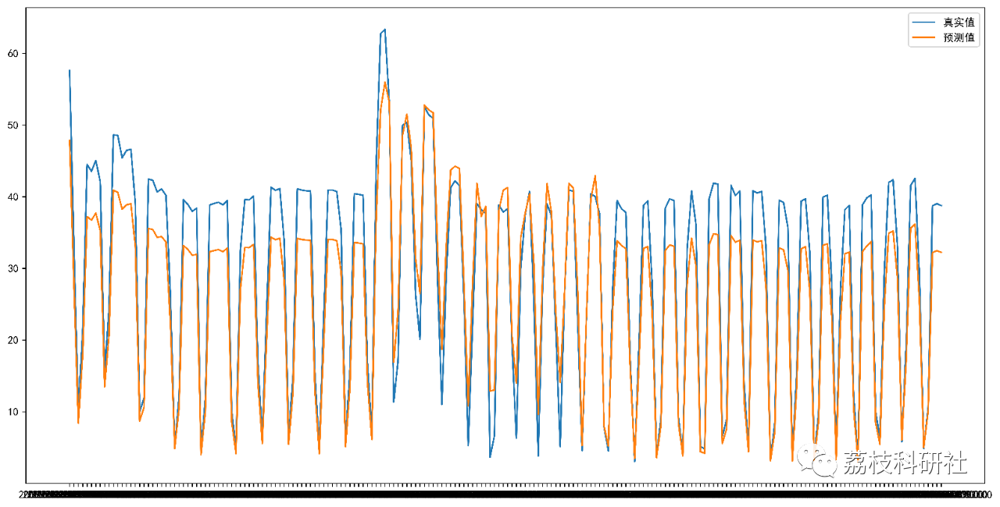

# Time Series Forecasting | Load Forecasting Based on Multivariate Linear Regression (Python Code Implementation)

💥💥💥💞💞💞💞 Welcome to this blog❤️❤️❤️💥💥💥
🏆 Bloggers' Advantage: 🌞🌞🌞 The content of the blog strives to be rigorous in thought and clear in logic, for the convenience of readers.
​  
⛳️ Mantra: The journey of a hundred miles is half done in the last ninety.
🎁Column Directory:
🌈🌈🌈🌟🌟🌟Electrical Code Intelligent Algorithm and Its Application Path Planning Neural Network Predictive Optimization Scheduling Image Processing Workshop Scheduling Signal Processing Romantic Her Complete Code Matters
💥1 Overview
In fact, electricity consumption forecasting for households is merely a "prelude". If grid data is available, models can be developed to meet business needs, such as predicting electricity usage across different time periods and regions to assist in better power dispatch; additionally, it can also be used for power generation forecasting, including photovoltaic power stations, wind farms, hydropower plants, etc. The model itself is not the issue; the key lies in the data and data processing.
📚2 Data
This dataset is a multivariate time series dataset, which collected the electricity consumption of a family in Paris, France for nearly four years (from December 2006 to November 2010), with a sampling period of 1 minute. The attributes information of the dataset is as follows:
Date: dd/mm/yyyy
Time: format hh:mm:ss;
Global Active Power: The active power per minute (kilowatts).
Global Reactive Power: The reactive power per minute (kilowatts);
Voltage: The average voltage per minute (volts);
global_intensity: The average current strength (amperes) per minute
Sub-metering 1: Kitchen Power Consumption (Watt-hours), mainly including dishwasher, oven and microwave;
Sub-metering 2: Power consumption in the laundry room (in watt-hours), including washing machines, drum dryers, refrigerators, and lights.
Sub-metering 3: Electric water heater and air conditioner power consumption (watt-hours).
🎉3 Running Results
👨‍💻4 Python Code
Click the article's lower left corner to [Read Full Article]
Or reply with the keyword: Multivariate Linear Regression for Load Forecasting 2
💥End Notes

## Images

<!-- PAYMENT_BLOCK -->

## Get this dataset

- Payment link (Stripe): [Buy now](https://buy.stripe.com/3cs8yP7sY87d0vu9AB)
- Payment QR code: 

<!-- /PAYMENT_BLOCK -->
